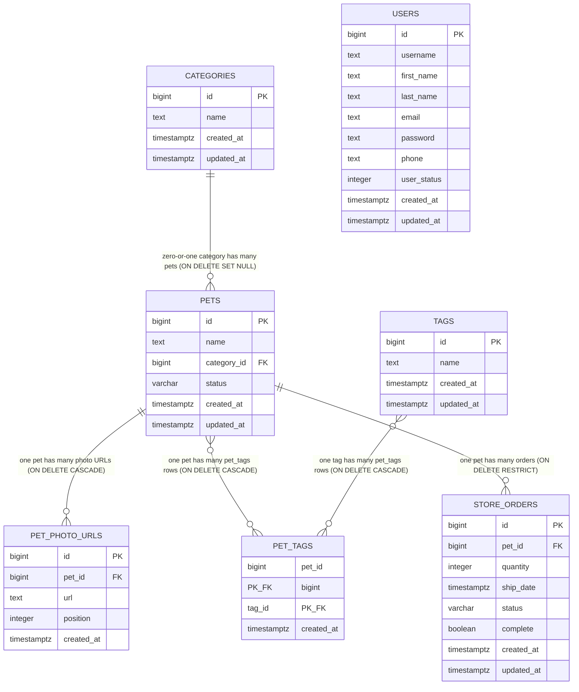

# Petstore Database — Entity-Relationship Diagram

Mirrors the schema created by `packages/api/migrations/` (changesets 0001–0009). See
`specs/001-db-schema-migration/data-model.md` and `contracts/schema.md` for the full column/constraint
detail this diagram summarizes. Whenever the migration changes, update this diagram in the same change.

## Reading this diagram

- **Pet → Category**: optional (a pet may have no category); deleting a Category detaches its
  Pets rather than deleting them.
- **Pet → Tag**: many-to-many through `PET_TAGS`; deleting a Pet or Tag removes only the
  association row, never the other side.
- **Pet → Photo URL**: one pet, many ordered photo URLs; deleting a Pet deletes its photo URLs.
- **Pet → Order**: one pet, many orders; a Pet **cannot** be deleted while it still has an Order —
  the delete is rejected, not cascaded, so order history is never silently lost.
- **Users** has no foreign-key relationship to any other table in this schema — the OpenAPI
  contract does not link Orders or Pets to a User.
